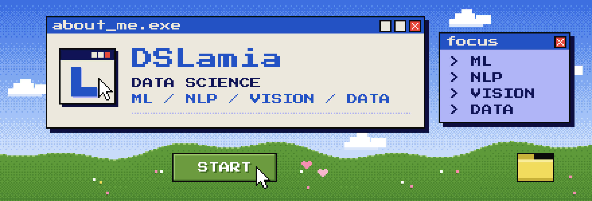

<!--
  GitHub profile README for github.com/DSLamia  (repository: DSLamia)
  Edit the text freely. The pixel graphics live in /assets and are generated by design-source/make_assets.py.
  Layout rules: text stays in Markdown; images are decorative and have alt text.
-->

<a href="https://lamia-projects-portfolio.netlify.app/">
  
</a>

<br>

**Data Science graduate** building practical projects in machine learning, NLP, computer vision and data analytics: preparing the data, training and evaluating models, and turning the results into something that runs.

<br>


```text
SUBJECT ...... DSLamia
FUNCTION ..... Data Science graduate
FOCUS ........ Machine Learning · NLP · Computer Vision · Data Analytics
BUILDS ....... practical projects, from raw data to a working model or app
PORTFOLIO .... https://lamia-projects-portfolio.netlify.app/
```

<br>


<table>
<tr>
<td width="50%" valign="top">

**▶ [Contract-Risk-AI](https://github.com/DSLamia/Contract-Risk-AI)**<br>
NLP-based contract clause classification using TF-IDF, Logistic Regression and an LSTM.<br><br>
`Python` `scikit-learn` `TensorFlow` `NLTK`

</td>
<td width="50%" valign="top">

**▶ [AI-Driven-Pottery-Classification](https://github.com/DSLamia/AI-Driven-Pottery-Classification)**<br>
Computer vision project using a custom CNN and MobileNetV2 transfer learning to classify handmade and machine-made pottery.<br><br>
`Python` `TensorFlow` `Keras` `CNN`

</td>
</tr>
<tr>
<td width="50%" valign="top">

**▶ [Hajj Health Risk System](https://github.com/DSLamia/hajj-health-system)**<br>
An AI-powered system combining weather information and health-risk prediction to support health-related decision-making during Hajj.<br><br>
`Python` `Flask` `ONNX Runtime` `Supabase`

</td>
<td width="50%" valign="top">

**▶ [Diabetes-Classification-Nonlinear-SVM](https://github.com/DSLamia/Diabetes-Classification-Nonlinear-SVM)**<br>
Machine learning project involving nonlinear SVMs, feature selection, SMOTE and model comparison.<br><br>
`Python` `scikit-learn` `imbalanced-learn`

</td>
</tr>
</table>

<br>


| | |
|---|---|
| **Languages & data** | `Python` `pandas` `NumPy` |
| **Machine learning** | `scikit-learn` `SVM` `Random Forest` `Logistic Regression` `KNN` `Decision Tree` `SMOTE` `feature selection` `GridSearchCV` |
| **Deep learning** | `TensorFlow` `Keras` `CNN` `LSTM` `transfer learning (MobileNetV2)` `ONNX Runtime` |
| **NLP** | `NLTK` `TF-IDF` `text classification` |
| **Computer vision** | `image classification` `image preprocessing` `data augmentation` |
| **Data analysis & visualization** | `pandas` `Matplotlib` `Seaborn` `exploratory analysis` |
| **Apps & tools** | `Flask` `Supabase` `Hugging Face Datasets` `Jupyter` `Google Colab` `Git` `GitHub` |

<br>


- ▶ **Portfolio:** [lamia-projects-portfolio.netlify.app](https://lamia-projects-portfolio.netlify.app/)
- ▶ **GitHub:** [github.com/DSLamia](https://github.com/DSLamia)

<br>


